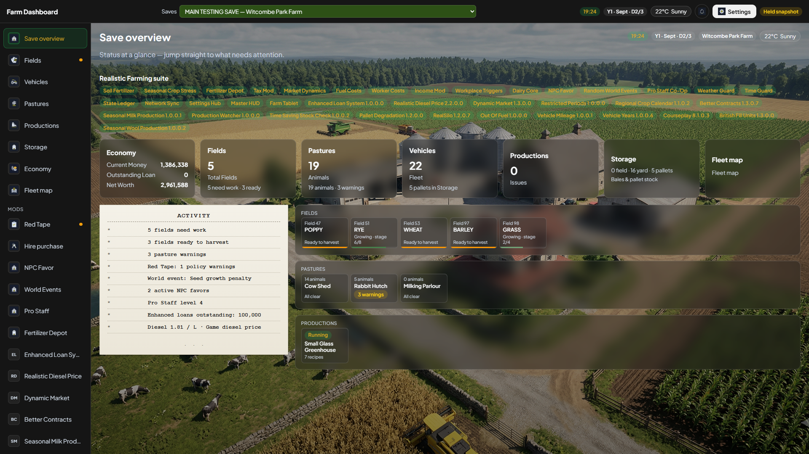
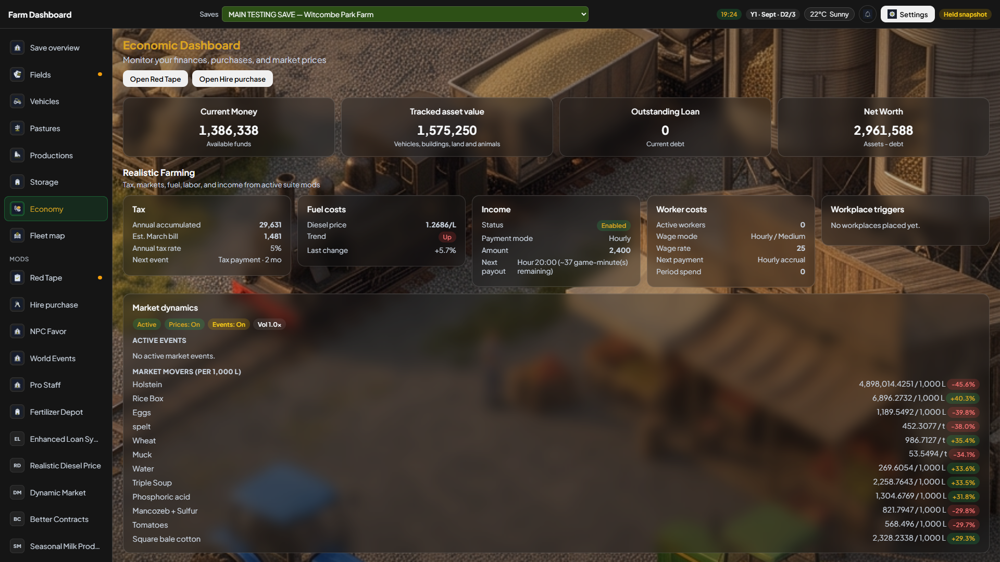
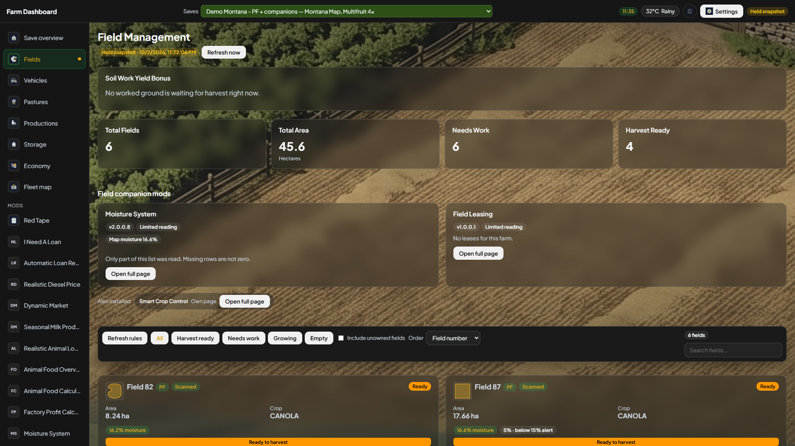
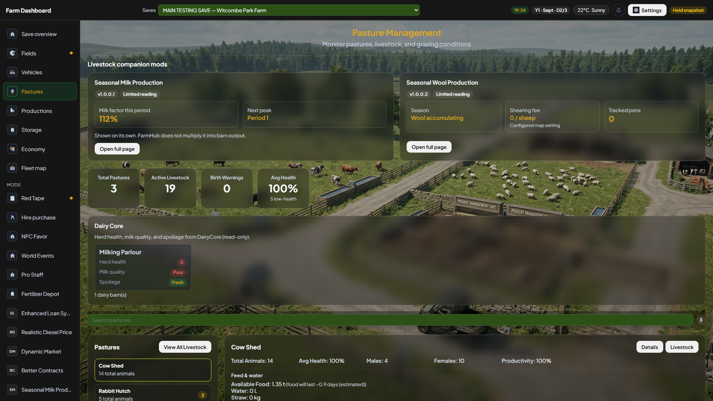
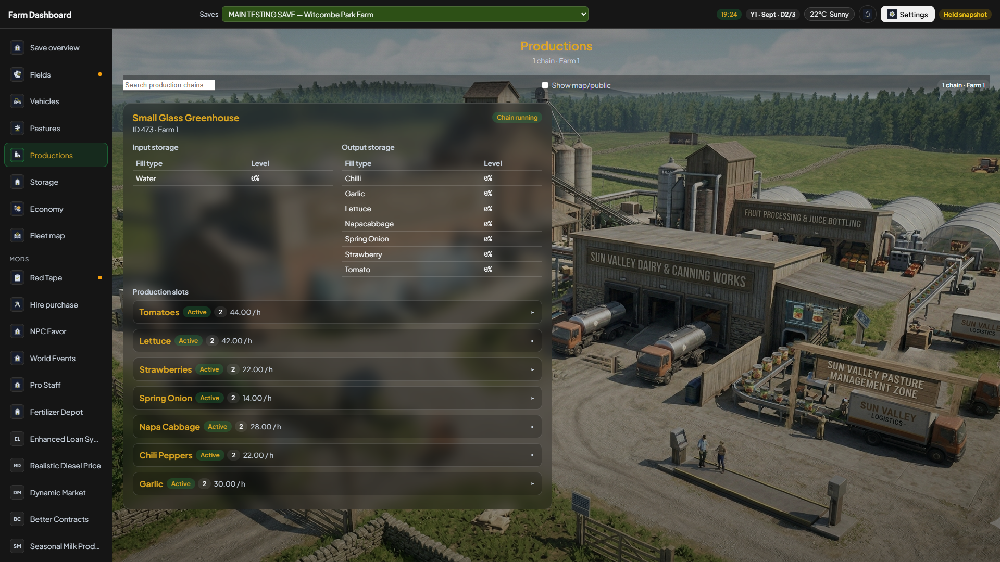
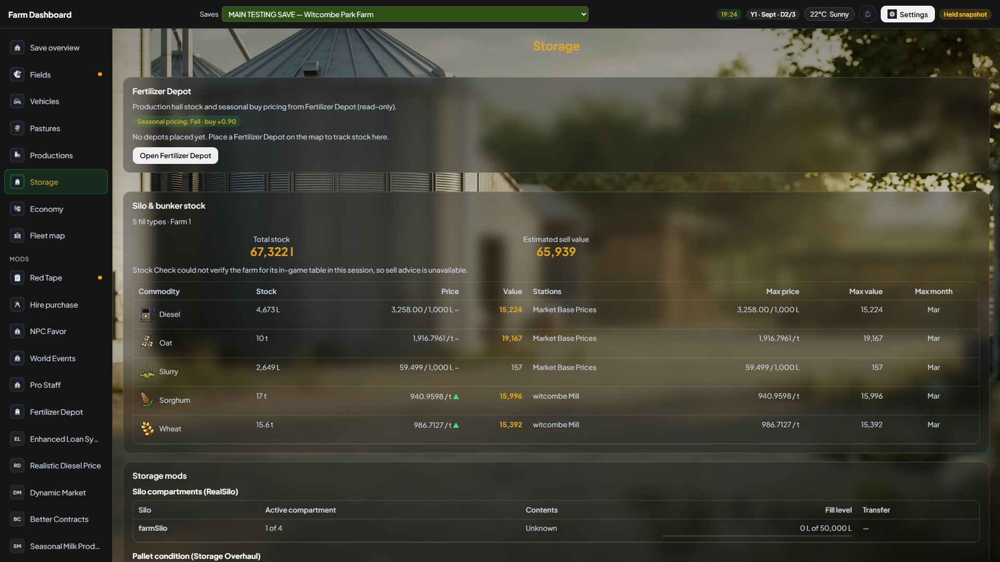
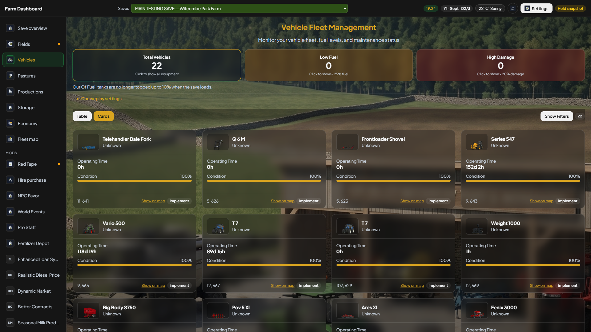

# Optional mods: what Farm Dashboard actually shows

You need only **FS25 Farm Dashboard** for the normal dashboard. The following are **optional**. A companion appears only when FS25 loaded it for the selected save; leaving a ZIP in the mods folder is not enough. Each reader is intended to work independently, so one missing or failed mod does not require another to be switched on.

These descriptions target the prepared **V5 5.1.17 / game mod 5.1.0.9** candidate. Optional panels appear only when their mods are loaded; no companion is required for the base dashboard. Screenshots of held demo saves illustrate layout and recorded data, not a live gameplay test of every possible mod combination.

## Read the labels first

- **Live:** the companion catalog maps an exported data block.
- **Limited:** selected settings, totals or farm rows, not the mod's complete in-game menu.
- **Detected/reference:** the dashboard can name the loaded mod and explain it, but the catalog does not promise live numbers.
- **Direct/folded:** a separate collector or core page can show data even if the general catalog entry is reference-only. Look where players normally expect it, such as Vehicles or Fields.

The dashboard never buys, sells, repairs, borrows, leases, alters production, or changes another mod's configuration. Any decision suggested by a card is still yours to carry out inside FS25. Some mods have their **own** dependencies or conflicts; those are game rules, not Farm Dashboard requirements.

## Existing dedicated integrations

- **Red Tape:** policies, tier, compliance and rotation history for the farm. [Screen](doc-screenshots/current-5057/suite-redtape.png).
- **Advanced Damage System (ADS):** workshop, breakdown and machine-attention details. [Screen](doc-screenshots/current-5057/suite-ads.png).
- **Hire Purchasing:** active hire-purchase deals, amounts and remaining payments. [Screen](doc-screenshots/current-5057/suite-hirepurchasing.png).
- **Invoices:** a separate page when that mod is loaded. None of the current demo saves has it; a genuine screenshot is still needed.
- **Precision Farming:** alternative soil source for Fields, not a prerequisite for the dashboard or Soil Fertilizer. [Fields example](doc-screenshots/current-5057/pf-fields.png).

## Finance and loans

- **Enhanced Loan System — live:** Economy can read its loan terms and balances; the dedicated page helps explain the active loan. You still borrow and repay in-game. [Page screenshot](doc-screenshots/current-5057/mod-enhancedLoanSystem.png).
- **Automatic Loan Repay — live:** shows the configured repayment hour and cash-protection rule when exported. It does not trigger a repayment. [Page screenshot](doc-screenshots/current-5057/mod-automaticLoanRepay.png).
- **I Need A Loan — reference page:** explains the mod's loan-shopping flow; the catalog does not promise a live application or approval figure. [Page screenshot](doc-screenshots/current-5057/mod-iNeedALoan.png).
- **No Credit — reference:** explains the cash-only rule. It does not imply that old debt was erased or that the dashboard can change the rule.

## Markets, diesel, statistics and farm economy

- **Realistic Diesel Price — live:** exported diesel price/preset information appears in Economy and its page. It does not change fuel prices. [Page screenshot](doc-screenshots/current-5057/mod-realisticDieselPrice.png).
- **Fluctuating Diesel Price — live:** the changing in-game diesel reading appears on its page when present. Do not combine it with Realistic Diesel Price into a made-up single price. [Page screenshot](doc-screenshots/current-5057/mod-fluctuatingDieselPrice.png).
- **Dynamic Market — detected in the general catalog; separate page:** the page can show exported market group moves and sell pressure when that data is available. Detection alone does not prove a live price. [Page screenshot](doc-screenshots/current-5057/mod-dynamicMarket.png).
- **Market Price Helper — reference:** the in-game price helper is described; no separate live helper ticker is promised by the catalog.
- **Enhanced Seasonal Prices — reference:** the mod has its own Seasonal Prices base dependency. Farm Dashboard does not read its changed buy prices from this catalog entry.
- **Statistics Extended — reference:** explains the expanded in-game statistics; it does not claim to import that entire screen.
- **Economic History — limited:** selected history rows can appear in Economy when exported, not a full audit of every game transaction.
- **VIP Order Manager — limited:** shows available VIP-order summary information; accepting or completing an order remains in-game.
- **Farm Reputation — limited:** selected reputation reading appears when exported; Farm Dashboard does not award or remove reputation.

## Fields, land, planting and moisture

- **Restricted Periods — live:** shows closed spreading windows and restrictions so you can plan fieldwork. The game mod still enforces the rule. [Page screenshot](doc-screenshots/current-5057/mod-restrictedPeriods.png).
- **Regional Crop Calendar — live:** shows the mod's regional planting/harvest calendar. It is not a new calendar invented by Farm Dashboard. [Page screenshot](doc-screenshots/current-5057/mod-regionalCropCalendar.png).
- **Soil Work Yield Bonus — limited:** reads tool bonuses and worked area awaiting harvest. It cannot perform fieldwork or promise a final yield.
- **Smart Crop Control — reference page:** concerns NPC crop allocation, not the player's own planting plan. The catalog has no live player-crop promise. [Page screenshot](doc-screenshots/current-5057/mod-smartCropControl.png).
- **Dynamic Field Prices — reference:** explains moving farmland prices; the catalog does not claim a live price list.
- **Farmland Marketplace — limited:** reads this farm's exported offers. It cannot accept, withdraw or create an offer.
- **Field Profitability Ledger — limited:** selected profit/cost rows appear when exported, not a guaranteed accounting total for every operation.
- **Yield Tracker — limited:** selected recorded yields appear when exported; it does not predict a crop's future yield.
- **Moisture System — limited and dedicated page:** shows available field/environment moisture readings. Do not treat missing moisture as zero. [Page screenshot](doc-screenshots/current-5057/mod-moistureSystem.png).
- **Field Leasing — limited and dedicated page:** reads exported lease information for the selected farm. It does not sign or terminate a lease. [Page screenshot](doc-screenshots/current-5057/mod-fieldLeasing.png).
- **Rent Your Field — limited:** shows relevant rental summaries when available; the rental action stays in-game.

## Contracts and work lists

- **Better Contracts — live:** its dedicated page can show exported contract information. Contract acceptance and mission progress remain in FS25. [Page screenshot](doc-screenshots/current-5057/mod-betterContracts.png).
- **Missions Expanded — reference:** explains extra mission types; this catalog entry does not promise a separate live mission feed.
- **Additional Contracts — reference:** identifies extra contract types. If it pairs with Better Contracts in-game, that is the mods' own arrangement, not a Farm Dashboard dependency.
- **Task List — limited:** selected tasks for the current farm can be read, not edited or ticked off from the dashboard.

## Livestock, milk, wool and animal care

- **Livestock Monitor — limited:** reads display mode, refresh information and visible alerts where exported. Full barn stock still belongs on Pastures.
- **Animal Food Overview — reference page:** helps explain food groups; the catalog does not treat that as a live feed level. [Page screenshot](doc-screenshots/current-5057/mod-animalFoodOverview.png).
- **Animal Food Calculator — limited:** reads its consumption scales and days-per-period, without scaling your stored feed a second time. [Page screenshot](doc-screenshots/current-5057/mod-animalFoodCalculator.png).
- **Realistic Animal Losses — reference page:** explains the care/risk behavior. A loaded mod does not prove a current animal-loss count. [Page screenshot](doc-screenshots/current-5057/mod-realisticAnimalLosses.png).
- **Realistic Milking Times — reference:** explains milking windows; no separate live timer is promised here.
- **Seasonal Milk Production — limited:** reads the current period factor; it does not change milk output. [Page screenshot](doc-screenshots/current-5057/mod-seasonalMilkProduction.png).
- **Animal Trader — reference:** the placeable trader has its own buy/sell rules. Ordinary animal and money totals remain on Pastures/Economy.
- **Stall Rental — reference:** describes eligible-horse boarding income; the catalog does not present a live stall-rent invoice.
- **Seasonal Wool Production — limited:** reads shearing month, fees and tracked pens, not each sheep's individual health. [Page screenshot](doc-screenshots/current-5057/mod-seasonalWoolProduction.png).
- **Animal Planner — limited:** reads selected planned animal figures when exported; it does not move animals.

## Productions, stock checks and distribution

- **Production Watcher — limited:** Farm Dashboard uses its own read-only warning rules on your exported productions because the mod's private alert list is not directly available.
- **Production Control — reference:** the mod changes speed and operating cost in-game. The catalog does not yet read its chosen speed.
- **Productions Manager — reference:** describes the in-game manager; no complete manager UI is imported.
- **Factory Profit Calculator — limited:** shows estimates based on available month/price helpers for this farm. Estimates are not booked profit, and the dashboard does not modify a production point. [Page screenshot](doc-screenshots/current-5057/mod-factoryProfitCalculator.png).
- **Time Saving Stock Check — reference/direct stock context:** its in-game stock/price page is not copied wholesale. Use V5 Storage and Economy for exported figures.
- **Production Schedule — limited:** selected schedule information can be read; start/stop decisions stay in-game.
- **Distribution Redux — limited:** selected distribution state can appear; routing is not changed by V5.
- **Farm Operations Dashboard — limited:** selected overview metrics can be folded into Save overview, not a duplicate full management app.

## Storage, silos, pallets and silage

- **Pallet Degradation — limited:** reads condition of this farm's pallets; it does not apply wear. [Page screenshot](doc-screenshots/current-5057/mod-palletDegradation.png).
- **RealSilo — limited:** reads compartment levels for this farm; it cannot change the silo layout. [Page screenshot](doc-screenshots/current-5057/mod-realSilo.png).
- **Silage Compaction Monitor — limited:** selected compaction state appears when available; compacting still happens in-game.

## Vehicles, service and driving

- **Advanced Maintenance — limited:** shows machine risk/locked zones and published stall odds; it does not roll a stall or repair a vehicle.
- **Extended Vehicle Maintenance — limited:** reads service/fault fields for this farm; no workshop job is started.
- **Realistic Vehicle Service — limited:** reads stored service/key state; no repair, tow or key action is sent.
- **Out Of Fuel — detection-only catalog, with direct fuel context:** the mod removes a safety top-up. The normal vehicle fuel warning is the game's fuel reading, not proof of a separate Out Of Fuel export.
- **Punctured Tires — direct Vehicles reading:** tyre/puncture state can be folded into vehicle cards when exported, although the general catalog has no live key.
- **Collision Damage — direct Vehicles reading:** selected session hits/settings can be shown; the dashboard does not cause damage.
- **Vehicle Mileage — direct Vehicles reading:** odometer/trip readings are shown where exported. The general catalog label alone does not describe this older direct integration.
- **Vehicle Years — direct Vehicles reading:** model-year information can be shown for your fleet; it does not alter the shop.
- **Courseplay — direct Vehicles reading:** loaded course and progress can be shown; V5 does not start or change a Courseplay job.
- **Implement Usage Counter — reference:** explains operating-use counts, without promising a dedicated live dashboard counter.
- **Ingame Time Operating Hours — reference:** describes changed hours/fuel calculations; do not assume it only relabels an hours field.
- **Bushel Plus — direct Vehicles reading:** fitted units and combines can be listed where the collector exports them.

## Units and money display

- **Save Unit Profiles — limited:** shows the active save's unit/currency profile when exported. It does not rewrite the save profile.
- **Imperial System — display integration:** fill amounts may follow US gallons, bushels, pounds, US tons and feet. Check the unit label before comparing screenshots.
- **British Fill Units — display integration:** solids can display by kg/tonne while liquids remain litres. Do not silently convert a price-per-tonne to a per-litre price.

## Realistic Farming suite, one mod at a time

The RF suite is **optional**. The following names are pinned in the app's About panel from a **September 2026 local version list**; those pins are not proof that a newer release has passed all gameplay tests. An RF mod can be loaded alone if its own game requirements allow it. The dashboard reader for one mod must not require an unrelated RF companion.

- **Soil Fertilizer:** Fields soil nutrients, pH/lime, treatment guidance and organic matter on a **0-10 scale**. Do not combine its soil bars with Precision Farming. [Fields](doc-screenshots/current-5057/suite-fields.png).
- **Seasonal Crop Stress:** field moisture/stress and approximate outlook when exported. An outlook is not a guaranteed future weather event. [Fields](doc-screenshots/current-5057/suite-fields.png).
- **Fertilizer Depot:** production-hall bins and orders in Storage/its own tab; **not** the walk-in shop book. [Tab](doc-screenshots/current-5057/suite-fertilizerdepot.png).
- **Tax Mod:** Economy tax data. Some totals are global in the mod, not genuinely per-farm. [Economy](doc-screenshots/current-5057/suite-economy.png).
- **Market Dynamics:** Economy market movement. It does not let V5 set a price. [Economy](doc-screenshots/current-5057/suite-economy.png).
- **Fuel Costs:** Economy fuel expense/trend; source-reported stable trends may be labelled flat. [Economy](doc-screenshots/current-5057/suite-economy.png).
- **Worker Costs:** wage/roster summaries; source may share totals across farms. [Economy](doc-screenshots/current-5057/suite-economy.png).
- **Income Mod:** income summaries; global source figures can repeat across farms. [Economy](doc-screenshots/current-5057/suite-economy.png).
- **Workplace Triggers:** exported workplace/economy information, read-only. [Economy](doc-screenshots/current-5057/suite-economy.png).
- **Dairy Core:** dairy health/milk/quality details in Pastures when present. [Pastures](doc-screenshots/current-5057/suite-pastures.png).
- **NPC Favor:** active favors and relationships on its own tab. Shared relationships in the mod are not falsely called per-farm. [Tab](doc-screenshots/current-5057/suite-npcfavor.png).
- **Random World Events:** current event/cooldown on its own tab and Overview. No source history API means no invented history. [Tab](doc-screenshots/current-5057/suite-worldevents.png).
- **Pro Staff Co-Op:** membership, level and discounts on its own tab. [Tab](doc-screenshots/current-5057/suite-prostaff.png).
- **Weather Guard:** extra weather telemetry and forecast in the weather panel; it can differ from the current in-game sky. [Older V5 weather illustration](doc-screenshots/v5-modal-090-weather.png).
- **Time Guard:** calendar/time enrichment where exported; it does not change the game clock.
- **Farm Tablet:** **presence only** in V5; Farm Dashboard is not the Farm Tablet app.
- **State Ledger:** **presence only**; no state-editing controls.
- **Network Sync:** **presence only**; no network administration panel.
- **Settings Hub:** **presence only**; no settings takeover.
- **Master HUD:** **presence only**; no HUD controls.
- **RF Soil Scanner:** **presence only** in this dashboard catalog; do not infer live scanner measurements.

If a section is blank, first check the selected save and **Health**. A missing optional-mod reading is not a reason to delete the farm or enable every mod. For a precise support report, include app/mod versions, the loaded-mod list, map, source state and completed export generation. See [Troubleshooting](TROUBLESHOOTING.md).
