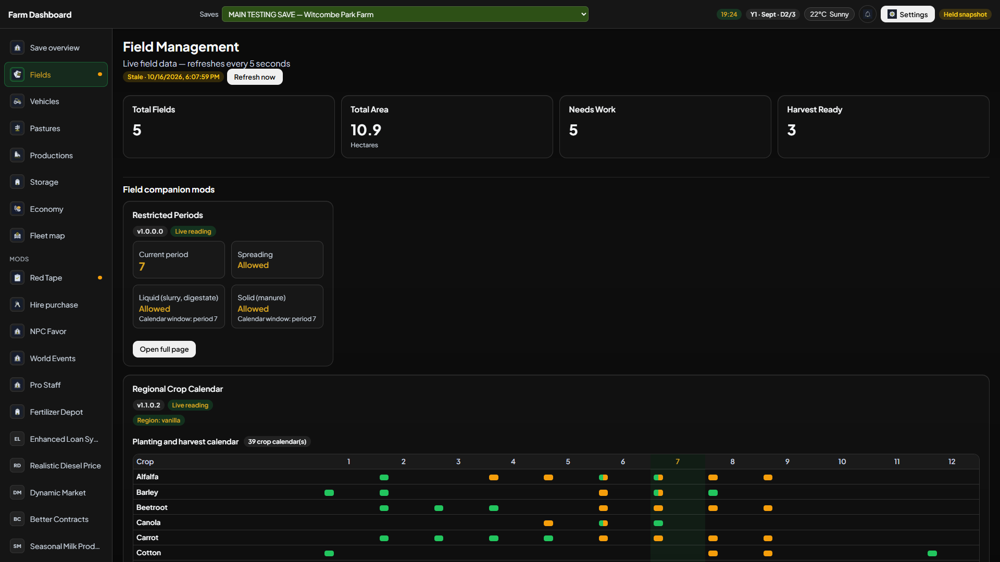

# V5 compatibility: what works together

Farm Dashboard V5 works with **the Farm Dashboard mod by itself**. Optional companions are additions, not a required pack. A companion contributes data only if it is **loaded for the selected save** and exports a reading the dashboard understands. A ZIP merely sitting in `mods` is not live data.

## Four support levels

- **Live reading:** the dashboard reads a companion value for a page or core section.
- **Limited reading:** selected settings or summaries, not the whole in-game interface.
- **Detected/reference:** the loaded mod can be named and explained, but no live statistic is promised.
- **Not mapped:** the catalog has no data contract. Some older direct integrations, such as Vehicle Mileage and Courseplay, still appear under Vehicles; see [Optional mods](COMPANION_MODS.md).

A detected mod with an empty block does **not** prove its gameplay failed. The dashboard is read-only: it cannot change prices, leases, animals, vehicles, or loans.

## Independent combinations

- No optional mods: Overview, Fields, Vehicles, Pastures, Productions, Storage, Economy, and Fleet map still work.
- One optional mod: only its related card/page/readings should appear; it does not require an unrelated companion.
- Several optional mods: readers are isolated. One failing reader must not erase another's data.
- **Precision Farming and Soil Fertilizer:** they are alternative soil sources. Do not combine their bars into an invented total. The dashboard selects and labels the source; neither is required for the rest of V5.
- A companion can have **its own** in-game dependency or conflict. Farm Dashboard cannot remove that game-level requirement.

## Versions and release boundary

- **Tested documentation candidate:** V5 app **5.0.57**, mod **5.0.0.31**, canonical ZIP `FS25_FarmDashboard.zip`.
- **Public V5 listing:** may still show **5.0.3 / 5.0.0.3** until the prepared **5.1.0 / 5.1.0.0** release is published. Use the version displayed on the actual download page.
- **Classic V4:** public **4.2.1** remains separate on **8766** and its own `latest.yml`. V5 uses **8768** and `latest-rf.yml`.
- V4 was **not retested** against mod 5.0.0.31 during this V5 pass. Do not infer a V4 compatibility result from it.

An About-panel pin saying a newer companion is **untested** means its version is newer than the recorded pin, not that the game rejected it. The [mod-by-mod guide](COMPANION_MODS.md) describes the dashboard surface; the [tester guide](TESTERS.md) describes the evidence needed for a compatibility claim.
