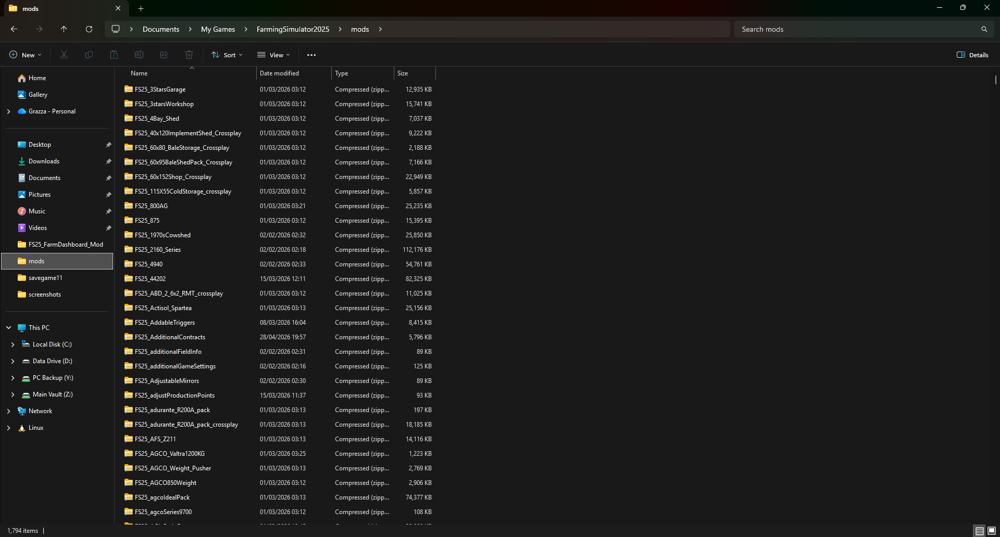
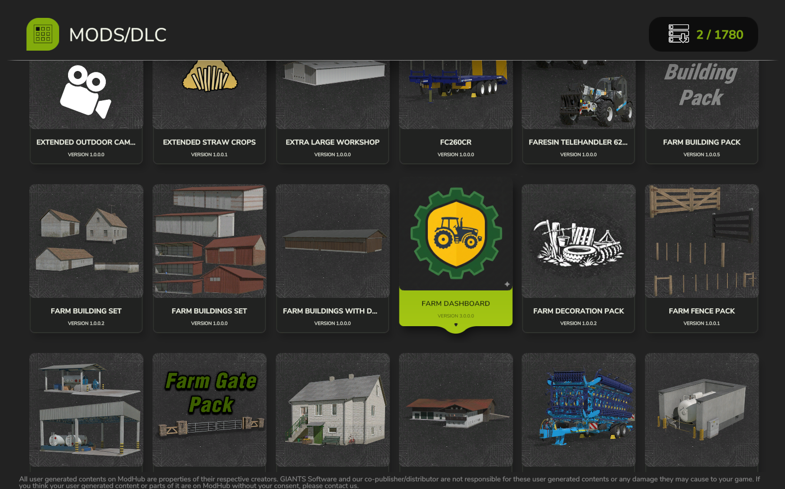
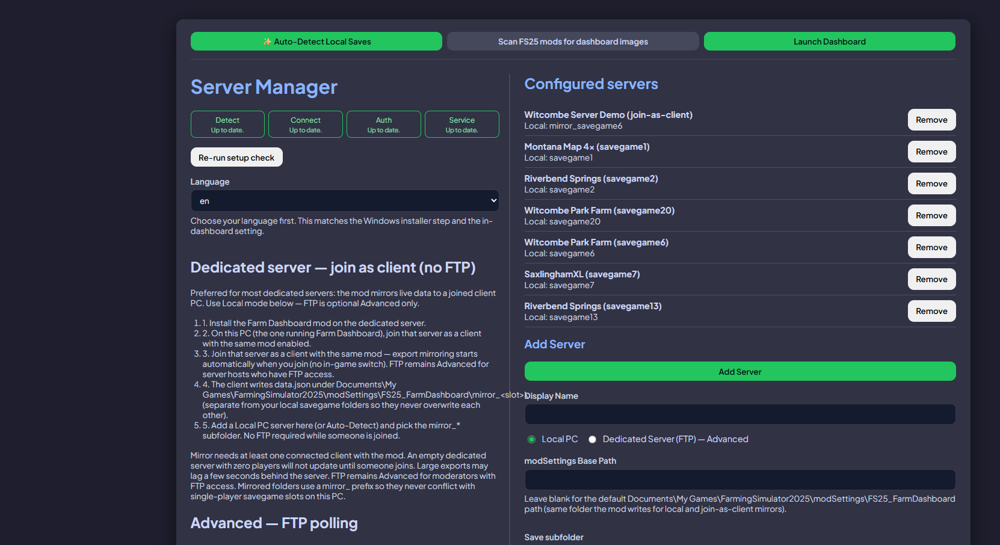

# Install Farm Dashboard V5

Farm Dashboard has **two parts**: `FS25_FarmDashboard.zip` runs inside Farming Simulator 25 and exports farm data; the V5 Windows app displays it. Install both. Keep the ZIP's exact name so FS25 sees **one** Farm Dashboard mod, not two entries.

> This guide describes the **5.2.0 app / 5.1.0.9 mod release**. Download both matching files from the same release.

## 1. Put the mod in the game

1. Close FS25 before replacing an older Farm Dashboard ZIP.
2. Put **one file named `FS25_FarmDashboard.zip`** in `Documents\My Games\FarmingSimulator2025\mods\`. Do not leave a version-suffixed second copy beside it.
3. For a dedicated server, install the **same ZIP** on the server. Joining clients also need the server's required mod version.
4. Tick **FS25 Farm Dashboard** on the save's mod-selection screen, then load fully into the world. A ticked ZIP at the main menu is not proof of a completed export.

The game normally writes under `Documents\My Games\FarmingSimulator2025\modSettings\FS25_FarmDashboard\`. A changing `data.json` size alone is not proof of a complete export: **Settings → Health** should show a completed, recent generation. An empty startup write is not farm data.

## 2. Install the Windows app

Run `FS25-Farm-Dashboard-V5-Setup-5.2.0.exe` from the V5 release, then launch **Farm Dashboard V5** from the Start menu. Installed V5 normally uses `http://127.0.0.1:8768` on this PC.

Mod-image import is optional. If an optional ImageMagick step fails, the dashboard can still show farm data; use its built-in conversion path or return to images later. Do not install ImageMagick just to make first launch work.

## 3. Choose your save

### Single-player or a game hosted on this PC

Use **Auto-detect** in Server Manager, choose the correct save, and launch. If you have several saves, use **Saves** at the top. Check the map name and a recent export after the game has been in-world long enough to finish a collection cycle.

*Older V5 setup illustration; candidate screens may differ slightly.*

### Dedicated multiplayer: join as a client

This is simplest when a player can join the server.

1. Put matching Farm Dashboard ZIPs on the **server** and the **client**.
2. Join the server in FS25 and enter the world.
3. If V5 offers **Link this server**, confirm the server you actually joined. If an old app entry vanished, complete a **fresh in-game re-pairing** challenge; do not trust a name-only match to an old token.
4. Select the new **multiplayer source** in the dashboard's Saves selector. The app stores a private replica for that linked server. Do **not** invent a `mirror_<slot>` path or point a Local source at another save's `data.json`.
5. Wait for a completed generation. Dedicated exports can take several minutes. After players leave, the last good picture becomes **held** rather than claiming the farm is live.

*This is a separate held demo save, not proof of a live multiplayer connection. Use Health for the active MP source.*

With **zero connected players**, the client route cannot refresh. Use FTP if you need unattended updates.

### Dedicated multiplayer: FTP (advanced)

An administrator can add **Dedicated server (FTP)** in Server Manager or **Settings → Servers & saves**. Use the server's real profile/modSettings location and save slot. Keep credentials private. FTP is scheduled polling, not the client mirror. The optional Giants HTTP/XML feed adds some data but does **not** replace the mod export.

## 4. Understand the status

- **Live/snapshot:** a completed generation arrived recently for the selected source.
- **Held/stale:** the last valid farm picture remains readable, but is no longer updating. Do not treat held money, weather, or advice as live.
- **Waiting/blocked:** no usable export is available yet, or the source needs linking.

The UI can trail the game clock by one export cycle. In the October two-client test, both clients reached the same server generation; the PC then moved to held after leaving the game. See [Using the dashboard](USER_MANUAL.md#understanding-live-held-and-stale-data).

## 5. If nothing appears

1. Confirm you opened **V5**, not the older classic window.
2. Confirm there is one canonical mod ZIP and it is enabled **for this save**.
3. Enter the world, then inspect **Settings → Health** for a completed generation and recent receipt.
4. Check the selected save/map. For MP, choose the linked MP source, not an old same-named Local source.
5. If held, reconnect or use FTP. If blocked, follow the linking action rather than deleting a save.

See [Troubleshooting](TROUBLESHOOTING.md) for more.

## Removing V5

Use **Windows Settings → Installed apps → Farm Dashboard V5 → Uninstall**. Keep data if you may reinstall; choose full removal only when you want the V5 profile cleared. The game save and separate V4 app must not be deleted by V5 removal. External shared software such as ImageMagick should not be assumed to disappear with the app. If Windows says the uninstaller EXE is missing, use the current V5 installer to repair it before uninstalling; do not delete random registry entries.

The genuine 5.2.0 installer welcome/finish screens have not been captured for this guide. This guide does not mislabel V4 installer screenshots as V5.
