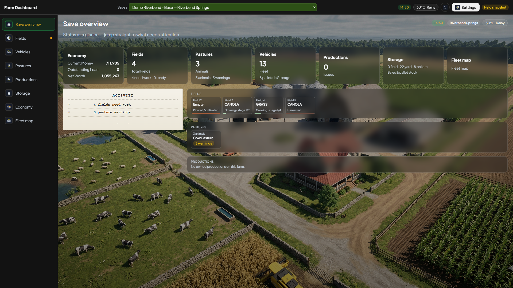

# Farm Dashboard V5: player help

This is the help pack for the **V5 Windows dashboard**. Start with [installation](INSTALL.md), then use the [manual](USER_MANUAL.md) while exploring the screens. The [optional-mod guide](COMPANION_MODS.md) explains each supported or catalogued mod without pretending every mod provides live data.

## Which version?

- **Repository target:** Windows app **5.2.7** with the canonical `FS25_FarmDashboard.zip` mod **5.1.0.12**. Use matching files from one [release](https://github.com/WizardlyPayload/FarmHub/releases); the public 5.2.0 release remains available while this candidate is prepared.
- **Acceptance boundary:** the exact 5.2.6/5.1.0.12 pair passed the PC Catuaí orchard check and bounded Ally installation, DLC, map, image, and Keep uninstall/reinstall checks. App 5.2.7 updates a packaged dependency; its PC installation and Catuaí pages passed, and the exact 5.2.7 installer passed an app-only Ally install/Keep/reinstall with restoration. The game was not reloaded for 5.2.7 because the mod ZIP is byte-identical. See the [DLC acceptance record](../DLC-COVERAGE-AUDIT-2026-10-28.md) for gameplay observations and limits.
- **Classic V4:** a separate product line. Its public 4.2.1 story and update feed have not been changed. This V5 pass was **not** a new V4 test.

## Find the answer you need

- [Install and first launch](INSTALL.md): mod ZIP, Windows installer, single-player, dedicated linking, FTP, and removal.
- [Using the dashboard](USER_MANUAL.md): live versus held, every core section, settings, and alerts.
- [Optional mods, one by one](COMPANION_MODS.md): 64 catalogued companions and the RF suite, including detection-only limits.
- [Compatibility](COMPATIBILITY.md): independent combinations and Precision Farming versus Soil Fertilizer.
- [Screenshots](SCREENSHOTS.md): current-build captures, older illustrations, and images still needing a manual capture.
- [Troubleshooting](TROUBLESHOOTING.md): short symptom-first help.
- [Security and LAN](SECURITY.md), [V4 side-by-side](UPGRADE_FROM_V4.md), and [tester checklist](TESTERS.md).

The dashboard **reads** game and companion data. It does not plant, buy, repair, or change another mod's settings. The Farm Dashboard mod works without the optional suite.

*Installed V5 5.2.6 showing a held Riverbend demo save at 1920 × 1080. Held means saved data, not live gameplay.*

Screenshots in this pack must not expose FTP passwords, pairing secrets, or private player details.
