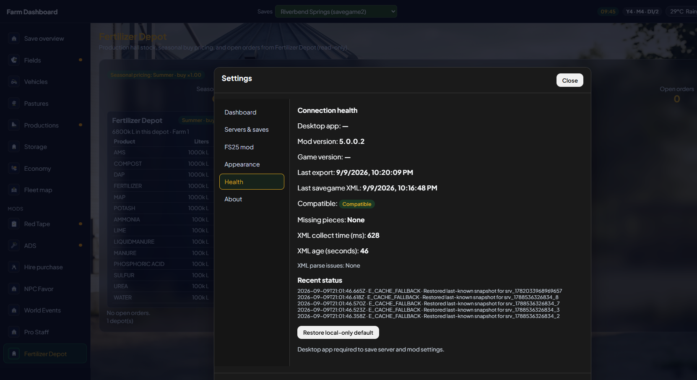

# Troubleshooting Farm Dashboard V5

Start with **Settings → Health**. Write down the selected save, map, app version, mod version, source state, last completed generation and last receipt time. A growing `data.json` or a green app badge by itself is not proof that the farm export finished.

## The window is blank or dark blue

Close and reopen **Farm Dashboard V5**. If it stays blank, use the current V5 installer to repair the app. Do not clear saves, modSettings, or Windows registry entries as a first step. Note the app version and whether Server Manager or the dashboard URL opens in a browser on the same PC; send a screenshot and the app log with any secrets removed.

## I installed everything but see no farm

Confirm the game mod ZIP is named **exactly** `FS25_FarmDashboard.zip` and enabled on **this** save. Load fully into the world and wait for a completed generation. Select the matching save in the top bar. If Health says waiting, follow its next action. If it says held, the picture is old rather than empty.

## The game shows two Farm Dashboard mods

Close FS25. In the mods folder, remove the **duplicate version-suffixed** Farm Dashboard ZIP from the active mods location, keeping only the canonical `FS25_FarmDashboard.zip` required by your server/release. Do not delete unrelated mods or a valuable game save. Restart the game and check its mod list.

## My dedicated save looks like an old local save

Choose the linked **multiplayer source** in Saves. Two same-named farms can be distinct sources. If its registration disappeared, use a **fresh in-game re-pairing** prompt; do not revive an old token from a same-name match. Check that the server and clients use the matching Farm Dashboard mod. The server is the export authority; clients should agree on the completed server generation even though their private source IDs differ.

## A multiplayer transfer timed out

One warning as a client enters the world can recover. Watch for **later committed generations** on the server and later receipts on the dashboard. If generations stop or the warning repeats, keep the game log and Health details, including the warning's phase and time. Do not call a timeout harmless merely because an older snapshot remains visible.

## Fertilizer, lime or moisture looks wrong

Check whether the save loaded **Precision Farming** or **Soil Fertilizer**. They are alternative soil sources, not additive passes. Organic matter is a 0-10 reading. A genuinely unavailable value should say unavailable, not zero. Record field number, map, crop, source mod and a same-moment game/dashboard screenshot. A held snapshot may simply predate the last fieldwork.

## Companion mods are missing

Check that each mod is **loaded for this save**, not only installed in the FS25 mods folder. Then consult [Optional mods](COMPANION_MODS.md): some entries provide full pages, some provide only a few readings, and some are detection/reference-only. Do not expect an unrelated mod to be required just to make another reader appear. If a reader fails, Health/game log should identify it without blanking other companion data.

## The dashboard is behind the game clock or shows held

Collection is staggered, especially on a dedicated server. Wait for the next completed generation. If FS25 closed or the client left, held is expected; reconnect for live updates or configure FTP for unattended server data. Do not use held stock or weather as a live decision.

## Windows cannot uninstall V5

If Installed apps says `Uninstall FS25 Farm Dashboard.exe` is missing, repair with the **same/current V5 installer** first, then uninstall through Windows. Choose Keep data or Full removal deliberately. Do not manually erase a game save, V4 installation or broad registry keys to fix a missing uninstaller.

## ImageMagick did not install or did not uninstall

Image import is optional. The dashboard's farm data does not depend on ImageMagick, and a bundled converter can cover supported assets. An external ImageMagick installation can be shared with other programs; do not promise V5 removal will remove it unless installer ownership is known. Report the installer message and log separately from a farm-data fault.

## Tablet cannot connect

LAN access is off by default. On the PC, enable it in **Settings → Servers & saves**, set a strong password and use `http://<PC-LAN-IP>:8768` from a trusted private network. `localhost` on the tablet means the tablet itself. Do not port-forward 8768 to the internet. Remote Setup is intentionally restricted. See [Security and LAN](SECURITY.md).

## Send a useful report

Include exact app/mod versions, map/save/farm, single-player or MP/FTP mode, loaded optional mods, source status, export generation, error text and a screenshot **without** passwords, pairing material or private player names. [Tester template](TESTERS.md#report-template).
