# Farm Dashboard V5: using your farm screens

This manual describes the **5.2.6 Windows app / 5.1.0.12 game mod candidate**. If the dashboard is not installed yet, start with [Install V5](INSTALL.md). Optional mods are described individually in [Optional mods](COMPANION_MODS.md).

Farm Dashboard is an **out-of-game, read-only companion**. It does not replace FS25's menus or control your farm. The game mod exports data, and the Windows app turns that data into pages you can use on another screen.

*Current installed V5 UI using a held Riverbend demo snapshot. A held picture is not live gameplay.*

## Your first minute

1. Load a save in FS25 with **one** `FS25_FarmDashboard.zip` enabled.
2. Open **Farm Dashboard V5**, pick the matching source in **Saves**, and check the map name.
3. Give the mod time to finish a full export; the first empty startup write is not enough.
4. Open **Settings → Health** if the screen is waiting or you are unsure which save it is reading. Look for a completed generation, last receipt, and any clear action message.
5. Start with **Save overview**, then use Fields, Vehicles, Pastures, Productions, Storage, Economy, or Fleet map.

## Understanding live, held, and stale data

- **Live or snapshot:** the selected source has delivered a recent, complete farm generation. The game clock can be a few minutes behind the in-game HUD because exporting is staggered.
- **Held:** the app keeps the last valid picture when the game closes or the source stops. It is useful as a reference, but do not act on it as current money, weather, stock, or job advice.
- **Stale:** the latest receipt is older than the source's freshness window. Held and stale often appear together after you exit FS25.
- **Waiting/blocked:** there is no usable export or the source needs an explicit link. Follow the suggested action; do not delete a save because the dashboard is waiting.

In dedicated multiplayer, the **server** is the export authority. Two PC clients can show the same server generation with different private local source IDs. A screenshot of a file size is not proof: compare completed generations in Health when troubleshooting.

## The top bar and sidebar

The **Saves** control chooses one configured source. The clock and weather are from that source's last export. The bell opens notification history; **Settings** opens the configuration and Health panes. The badge describes the app connection, not a guarantee that every companion reader is available.

The main sidebar always has **Save overview, Fields, Vehicles, Pastures, Productions, Storage, Economy, and Fleet map**, unless you hide a core section in Settings. Optional mod tabs appear only when the save provides the relevant detection or export. A yellow/orange dot is an attention marker, not a crash.

### Save overview

Use this for a quick farm check: money, fields needing work, harvest-ready land, animals, fleet warnings, storage, production and optional-mod signals. Click a block to go deeper. A missing optional chip can simply mean that mod is not loaded on this save.

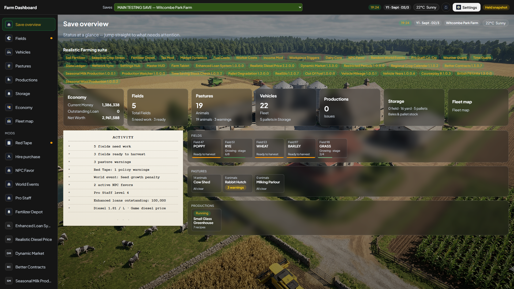

### Fields

Filter to **All, Harvest ready, Needs work, Growing, or Empty**. Search and sort by field number, crop, size, work, or soil urgency. **Include unowned fields** is off by default so the dashboard does not call the whole map your farm. A suggested next step is advice based on exported state, not an instruction sent to FS25.

Nitrogen, pH/lime, moisture and other soil bars need careful reading. Precision Farming and Soil Fertilizer are **alternative** sources; the dashboard should not add them together. Organic matter from Soil Fertilizer is a **0-10 reading**, not a percentage. If a soil value is missing, the app should say unavailable instead of inventing a zero. Field merges follow the same GPS-painted field, plus any groups you deliberately create; two neighbours with the same crop are not automatically one card.

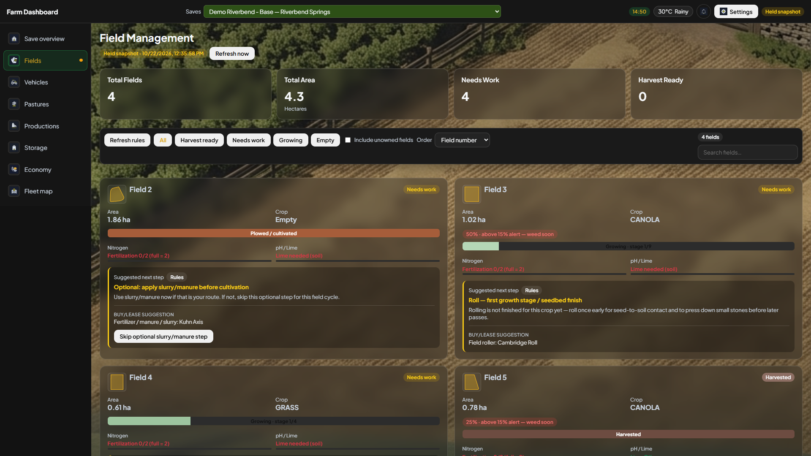

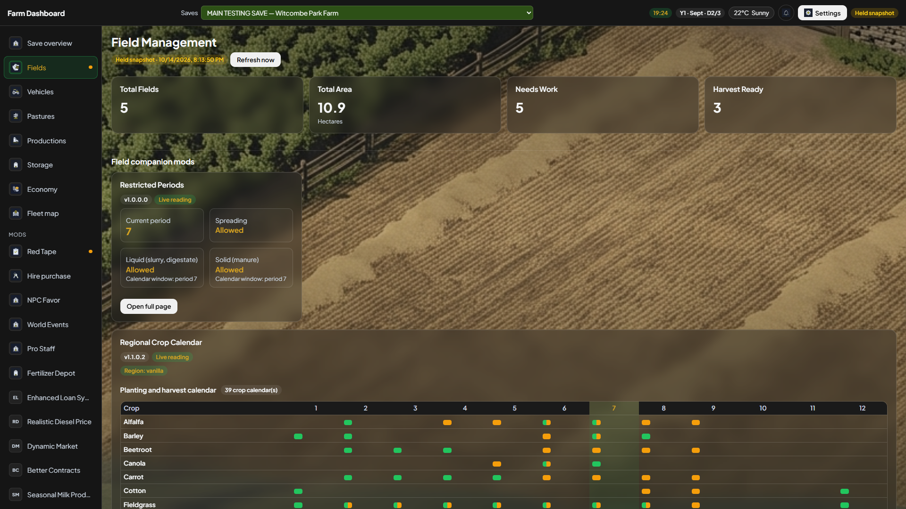

### Vehicles

Use the fleet filters for type, fuel, condition, or attention. A vehicle can show hours, damage, fuel and position when exported. Shop images are optional; a missing picture does not mean the machine is missing. Courseplay, mileage, model years, punctures, collision damage and other companions can add readings **only when present**. The ADS workshop is a separate mod-gated page.

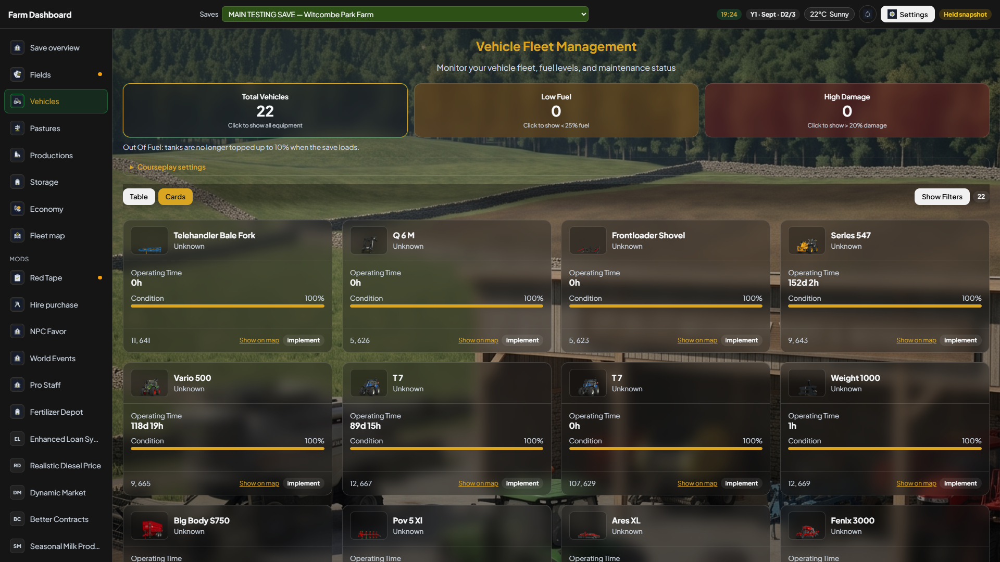

### Pastures and animals

Pastures is the V5 home for animal pens and livestock. Choose a pen for head count, feed, water, condition and animal details. Dairy Core adds dairy readings only when loaded. A count in a pasture summary can differ from a vehicle or store row count because these are different game objects, not duplicates.

### Productions

See your owned production chains, their running state, inputs and outputs. Optional Production Watcher warnings or profit estimates are read-only. A production list can be empty because you own none, a collector is off, or the last export is incomplete; Health helps distinguish these cases.

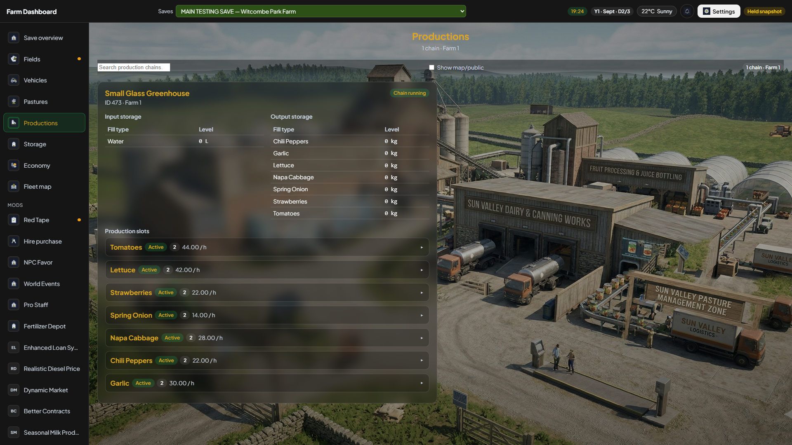

### Storage

Find silo and bunker amounts, bales, pallets and big bags. The **Fertilizer Depot** reading is its production-hall stock, not the small walk-in shop book. Companion readings such as RealSilo compartments or pallet wear appear only with those mods. Litres, weights and prices can follow a loaded unit mod; do not compare two screenshots until their units match.

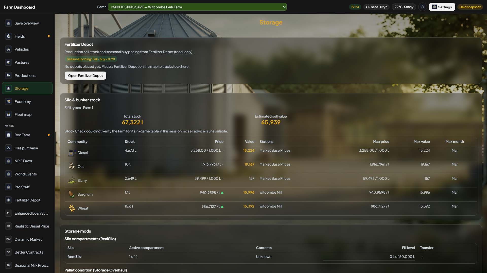

### Economy

See money, loans, prices, purchases and optional RF money blocks. Some RF tax, income, worker or NPC readings are shared/global in the underlying mod; the dashboard cannot turn them into a genuinely farm-specific total. Optional loan and market cards are information only: buying, borrowing and price changes happen in FS25.

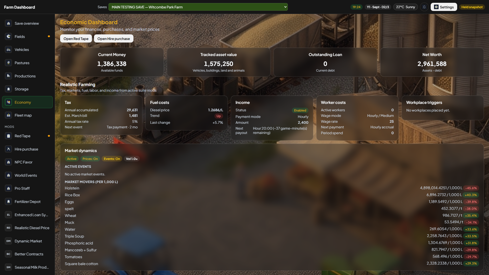

### Fleet map

Use the map to find exported vehicles and places against the save's overview image. Filters and layers help with crops, growth, ownership and soil where the source supplies them. If pins appear on the wrong map, check the selected save first; never reuse another map's cached image as proof of your current farm.

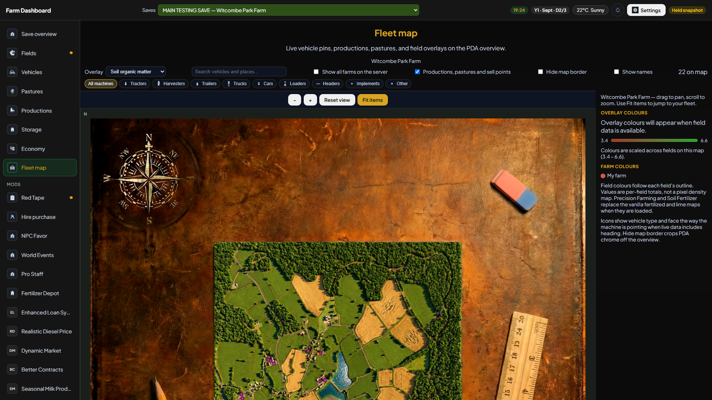

## Optional mod pages

The sidebar can add **Red Tape, ADS, Invoices, Hire purchase, NPC Favor, World Events, Pro Staff, Fertilizer Depot**, and dedicated third-party companion pages. It should not show dead tabs for unloaded mods. Some information is folded into Fields, Vehicles, Pastures, Productions, Storage, or Economy instead of getting its own tab.

The **Orchards** page brings grapes and olives together with supported expansion crops such as coffee and bananas when those orchards are present. It groups rows by farm ownership; an orchard crossing land owned by different farms is marked as partly owned rather than claimed entirely. Highlands Fishing, Pumps N' Hoses and Emergency Pack add small cards to Save overview only when their DLC is loaded in the selected save. The cards show the measurements the game exposes; a zero or unavailable value is not a claim that work was completed. See [Optional mods](COMPANION_MODS.md) for each card's limits.

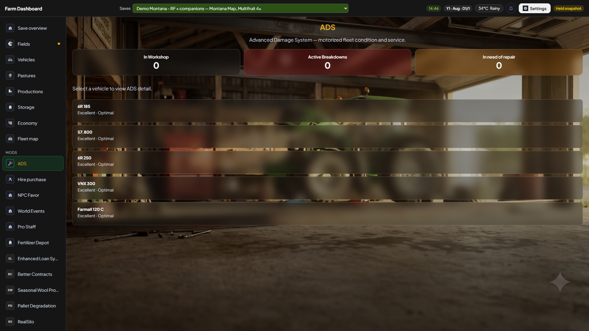

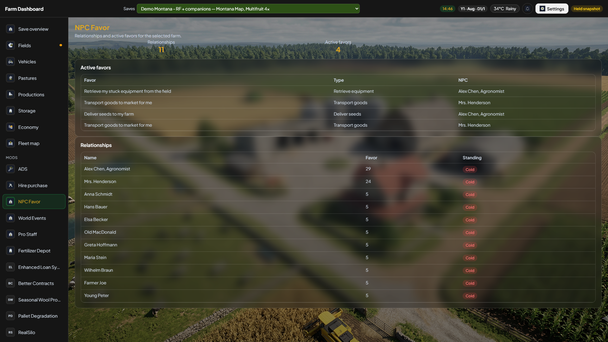

[Optional mods](COMPANION_MODS.md) gives the exact level of support for every catalogued mod and screenshots of all dedicated companion pages available in the demo saves. Do not assume that a detected mod has a complete live panel.

## Settings, in plain English

- **Dashboard:** hide/show core sections, choose the first page, and set field exclusions or deliberate field groups. These are display choices, not edits to a game save.
- **Servers & saves:** add/remove Local or FTP sources; manage LAN access; use Auto-detect or open Server Manager. After creating a new local save, run **Auto-Detect Local Saves** and **Save** to add it to the Saves list. A dedicated join-as-client source is linked by the game/app flow, not by guessing a `mirror_<slot>` folder.
- **FS25 mod:** collector timing and data modules. Changes to game-mod collection can require a save reload; changing display settings should not silently rewrite the game mod's `config.xml`.
- **Appearance:** language and theme. V5 already uses the new interface; classic V4 is a separate Windows installation.
- **Health:** last completed export, source status, compatibility and errors. This is the first stop for waiting/stale or missing companion data.
- **About:** app/mod versions and detected companion information. A newer-than-pinned mod marked untested is not automatically broken.

These Settings pictures were captured from the installed 5.1.17 desktop app, with private values hidden. The 5.1.18 dependency refresh did not include new screen captures:

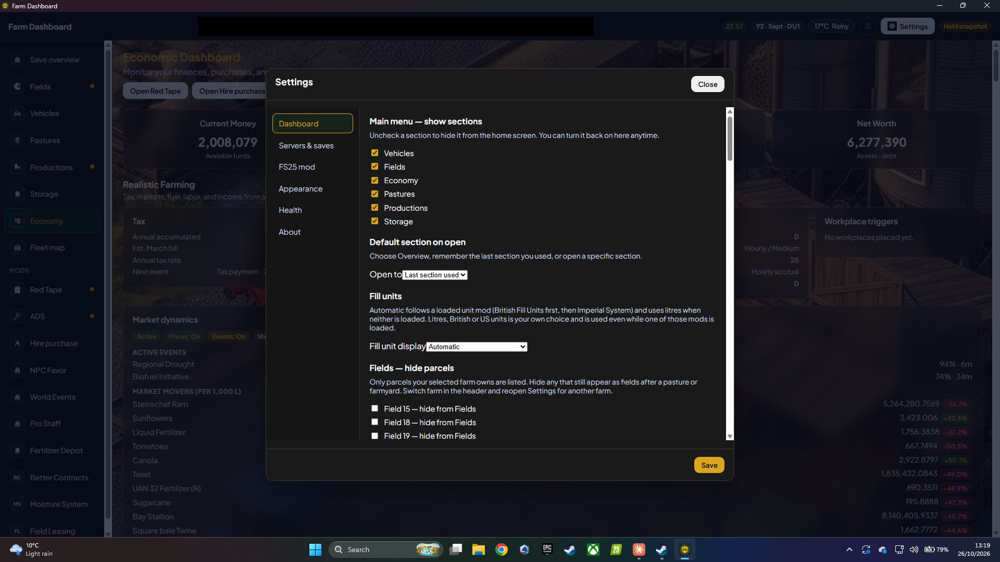

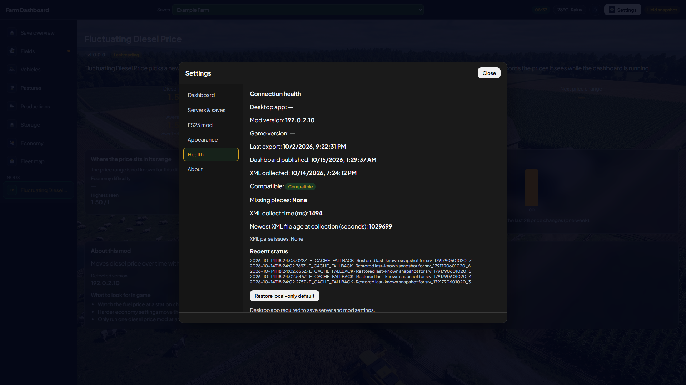

## Weather, alerts, and images

Click the top-bar weather pill for the forecast. Weather Guard can provide **companion telemetry**, which is not necessarily the same as the game's current sky. Click the bell for notification history; **No notifications yet** is a valid empty state. A delayed export can delay alerts. Mod shop-image import is optional and does not control farm-data availability.

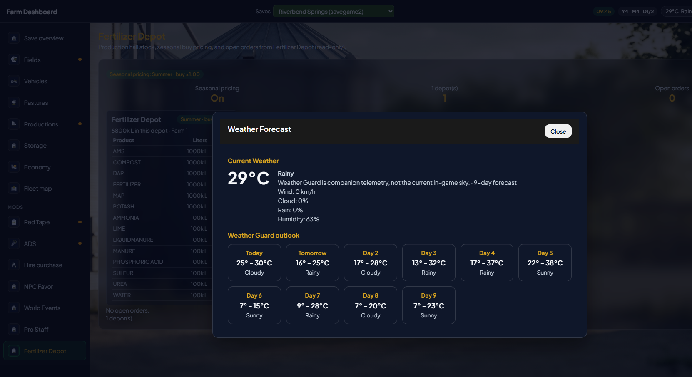

## Dedicated multiplayer and LAN

For a dedicated server, install matching Farm Dashboard mods on server and client, join FS25, then confirm **Link this server** or the fresh re-pairing prompt if shown. Choose the **multiplayer source**, not an old same-named Local source. When you leave, its last valid snapshot is retained as held. If nobody can stay connected, use FTP polling. [Install V5](INSTALL.md#3-choose-your-save) has the steps.

LAN viewing is **off by default**. Enable it only on a trusted home network, set a strong password, and visit `http://<PC-LAN-IP>:8768` from a tablet. Do not forward port 8768 to the internet or share screenshots of the password. Setup remains a same-PC task. See [Security and LAN](SECURITY.md).

## If something looks wrong

Use [Troubleshooting](TROUBLESHOOTING.md), then record **app version, mod version, map/save, selected source, live/held state, completed generation, and a screenshot without secrets**. That is more useful than saying only that `data.json` grew. The [tester guide](TESTERS.md) has a compact report template.
